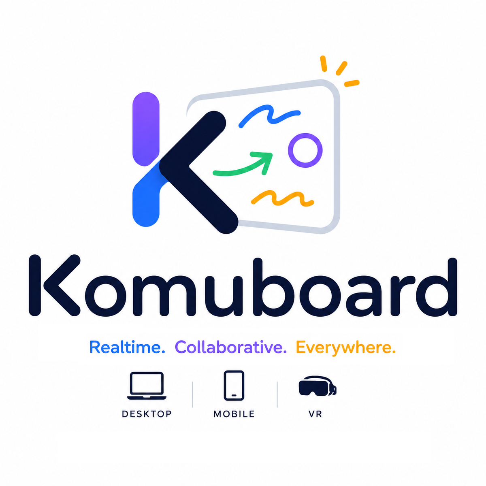
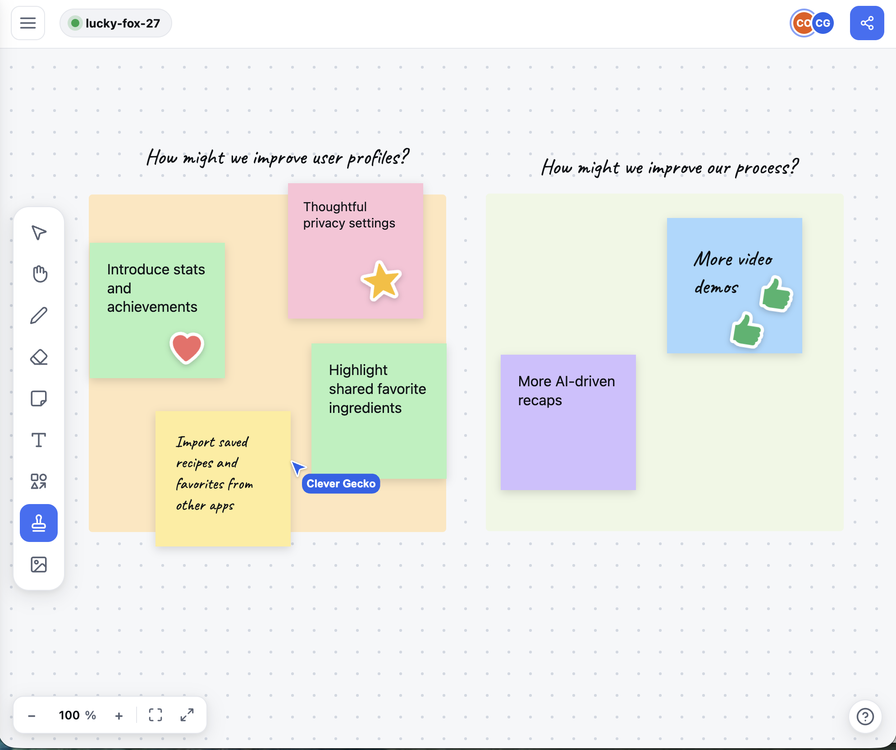
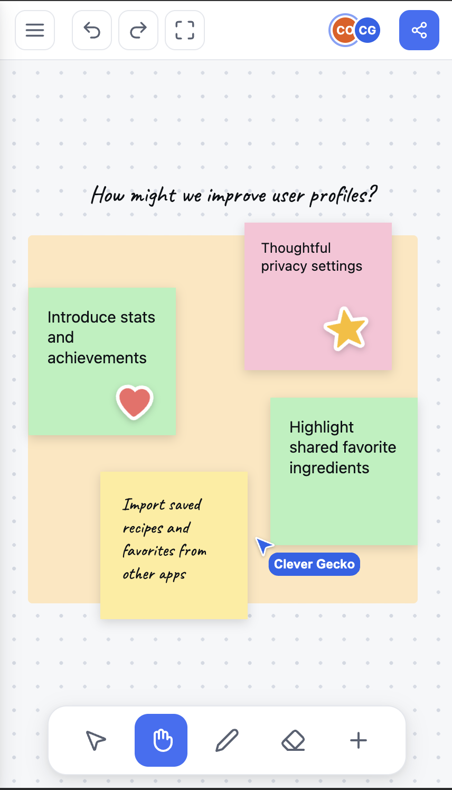
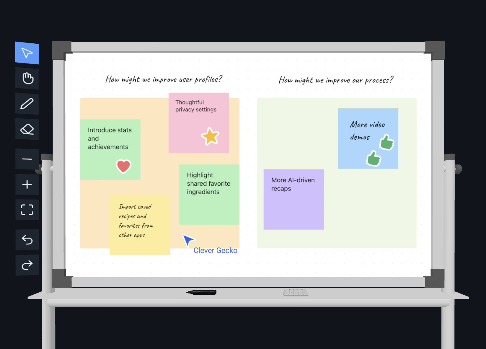

<h1 align="center">Komuboard</h1>

<p align="center">
  <a href="https://komuboard.app"></a>
</p>

<p align="center">
  <a href="https://github.com/donth77/komuboard/actions/workflows/ci.yml"></a>
  <a href="https://komuboard.app"></a>
  
  
  
  
  
  
</p>

**Komuboard** is a whiteboard that several people can draw on at the same time. It runs in the browser on a desktop, on a phone or tablet, and inside a VR headset through WebXR. You open a link, land in a room, and start drawing. There is no signup. While you work, you can see everyone else's cursor and who is in the room with you.

**Try it live at [komuboard.app](https://komuboard.app).**

## Screenshots

<div align="center">
  <table>
    <tr>
      <td align="center"><a href="brand/desktop.png"></a></td>
      <td align="center"><a href="brand/mobile.png"></a></td>
      <td align="center"><a href="brand/vr.png"></a></td>
    </tr>
    <tr>
      <td align="center"><b>Desktop</b> · mouse</td>
      <td align="center"><b>Mobile</b> · touch</td>
      <td align="center"><b>VR</b> · WebXR</td>
    </tr>
  </table>
</div>

## What you can do

**Draw and arrange things**

- **Pen and highlighter.** Pick a color, a thickness, and a solid or dotted line.
- **Sticky notes, shapes, and text.** A searchable shape library with basic and flowchart shapes, plus your own SVG outlines uploaded as custom shapes.
- **Connectors.** Arrows stay attached to objects and re-route themselves when you move things.
- **Stickers and images.** Emoji, stamps, and your own uploads.
- **The usual editing.** Erase, multi-select, group, lock, nudge with the arrow keys, undo and redo.
- **Infinite canvas.** Pan and zoom, and never run out of room.
- **Export.** The whole board as a PNG or PDF, on a grid, transparent, or solid.

**Work with other people**

- **Everyone edits at once.** Yjs (a CRDT) keeps the copies in step.
- **You see who is there.** Labeled cursors, presence avatars, joins and leaves.
- **Live, not after the fact.** Drags, resizes, rotations, and typing show up while they happen.
- **Anonymous rooms.** Share a code or a URL, with no signup. Boards are saved at the edge, so a room survives a reconnect.

**Put on a headset**

- **The same board, standing in 3D.** VR through WebXR.
- **Peers as 3D cursors.** Their edits and selections mirror as they happen.
- **The whole toolset.** Select, pan, pen, highlighter, and eraser, from a floating tool dock.
- **Or grab the props.** Grip the marker or the eraser, draw on the board, then drop it and it falls back into the tray.
- **No headset needed to try it.** A desktop "magic window" preview, with mouse + WASD.

Every device gets its own way in. A desktop mouse gets the full set of tools, touch on a phone or tablet stays fully usable, and VR is somewhere you work rather than somewhere you watch.

## How it is built

**The board itself**

- **TypeScript, Vite, pnpm workspaces.** One monorepo.
- **Yjs holds the board.** One document is the single source of truth.
- **Awareness holds everything short-lived.** Cursors, selections, VR avatar poses, and cursor-chat ride `y-protocols/awareness`, so they never touch the document.
- **Custom 2D renderer.** Bound to the Yjs document. It draws through the DOM so each object keeps its own z-order, and there is a documented path to WebGL later.

**Realtime and storage**

- **Cloudflare Workers and Durable Objects.** PartyServer gives every room its own Durable Object, and Y-PartyServer holds that room's Yjs document.
- **PartySocket on the client.** partysub shards rooms that grow very large.
- **One row per save.** Each save writes a compacted Yjs snapshot (`encodeStateAsUpdate`) into Durable Object SQLite as a single BLOB. No update log to grow.
- **Written the moment the room empties.** That is when the flush happens.
- **Images in Cloudflare R2.** D1 can hold a room index.
- **Hosting.** The SPA and VR assets sit on Cloudflare Pages (free CDN). Realtime and the API run on Workers and Durable Objects (free tier).
- **Anonymous first.** The room id is in the URL. Named accounts may come later.

**VR**

- **A-Frame and Three.js over WebXR.** The Yjs document is rasterized onto a 3D whiteboard surface.
- **Strokes drawn in VR go back into that same document.** Peer cursors, live edits, and selections sync through awareness.
- **Ships as a lazily-loaded chunk inside `client-web`.** You swap renderers in the same session, with no reload.
- **Tested without hardware.** An emulated-headset e2e harness (Meta `iwer`) covers the controller path in CI.

## Repo structure

```text
komuboard/
├── README.md                 # this file
├── package.json              # pnpm workspace root
├── pnpm-workspace.yaml
└── packages/
    ├── client-web/           # 2D SPA: renderer bound to Yjs, toolbar/panels
    │   └── src/vr/           # VR mode: lazy A-Frame renderer on the SAME doc/session
    ├── shared/               # shared types, Yjs schema, awareness protocol, utils
    └── worker/               # Cloudflare Worker + Durable Object (PartyServer / Y-PartyServer)
```

## Run it locally

You need Node 22+ and pnpm 9. Install, start the dev stack, then open two tabs on the same room and draw.

```bash
# Install all workspace dependencies (Node 22+, pnpm 9)
pnpm install

# Run the full local dev stack: worker (wrangler @ :8787) + web (vite @ :5173)
pnpm dev
# then open http://127.0.0.1:5173/?room=demo in two tabs to watch strokes, cursors, and selections sync
```

The same checks CI runs:

```bash
pnpm typecheck && pnpm lint && pnpm test   # vitest unit tests
pnpm test:e2e                              # boots worker + web, asserts realtime sync
```

## Deploy your own

You need a Cloudflare account. Create the R2 bucket once, deploy the worker, then build the web client against it.

```bash
# One-time: create the R2 bucket that holds uploaded images (binding "UPLOADS" in worker/wrangler.toml)
pnpm --filter @komuboard/worker exec wrangler r2 bucket create komuboard-uploads
pnpm --filter @komuboard/worker run deploy   # `run` — bare `pnpm deploy` hits pnpm's own deploy cmd

# Build the web client pointed at the deployed worker — VITE_WORKER_HOST (host only, no scheme) drives
# BOTH the realtime WebSocket and image upload/serve. Defaults to 127.0.0.1:8787 for local dev.
VITE_WORKER_HOST=komuboard-worker.<your-subdomain>.workers.dev pnpm --filter @komuboard/client-web build
```

Pushing to `main` does not deploy anything. Publishing the built site is a separate, manual Cloudflare Pages deploy.

## Asset credits

The VR scene uses three CC-BY models from Sketchfab:

- Whiteboard: [Low Poly Whiteboard by tankop1](https://sketchfab.com/3d-models/low-poly-whiteboard-1cbf089ec4b741ad9d092d15db6d55ba)
- Marker: [Whiteboard marker by Jimmy Johansson](https://sketchfab.com/3d-models/whiteboard-marker-904951bc3f2048fb83c62bb097958b55)
- Eraser: [Whiteboard eraser by Jimmy Johansson](https://sketchfab.com/3d-models/whiteboard-eraser-ced8b75f6ecc44c9b1503af9aa4f7d06)

## License

MIT. See [LICENSE](LICENSE).
